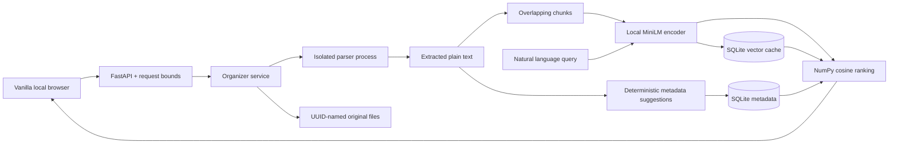

# Architecture

`extract.py` verifies suffix/signature where practical and parses PDF, DOCX body XML or UTF-8 text. It runs in `parse_worker.py`, invoked by a fixed Python-module command with bytes on stdin and JSON on stdout; uploaded text is never interpreted as instructions/code. The worker has an eight-second CPU limit when supported, 15-second parent timeout, and a 1 GiB address-space limit on Linux. macOS omits the unreliable address-space limit. PDF stream expansion is checked after decompression; the worker/resource limits reduce risk but do not guarantee safety from every malicious PDF. DOCX expanded archive size is checked before reading XML, and DTD/entities/path traversal are rejected.

`chunking.py` creates word windows. `embedding.py` loads one local safetensors model, caches it for server lifetime, and serializes CPU encoding through a lock. `setup_model.py` is the separate, explicit network-download step; it pins a revision and excludes unnecessary ONNX/OpenVINO/alternate binary weights. Runtime offline flags prevent accidental model fetches. The model can fall back to unavailable status without breaking keyword workflows.

`metadata.py` uses category-term frequencies and transparent coverage/separation strength; its output is a suggestion, not a trained-classifier probability. Summaries select high-scoring original sentences in document order, capped at 650 characters; the final sentence may be cut. Suggested titles/keywords/categories/summary are persisted alongside editable fields. This separation lets users correct metadata without losing the original explanation.

`store.py` owns SQLite schema/connections/transactions. Documents reference one optional collection. Chunks reference documents; vectors are cached by `(model ID, revision, normalization version, chunk-text hash)`. Little-endian float32 bytes and vector dimension are stored explicitly. Original files use UUID names; user filenames are presentation metadata. Duplicate file SHA-256 returns an existing record, including one in Trash. On a failed metadata insert the newly stored original is removed. Cache entries may outlive documents or failed uploads; this is intentional reuse and is bounded by this local workload, not an automatic garbage collector.

`service.py` serializes ingestion and rebuilds; computes best-chunk cosine; computes lightweight lexical coverage; combines both with a fixed hybrid formula. Metadata queries are parameterized; dynamic edit columns come only from a fixed allowlist. Metadata edits do not change content vectors. Reindex computes only missing vectors and updates keys after model revision changes. Trash toggles a flag and excludes records from default search/export; restore reuses the original index. Export is metadata-only, not a backup.

`app.py` has fixed routes, mandatory bounded write lengths, a bounded stream reader, and local Host/Origin validation. Parsing and ingestion run off the event loop. The upload UI sends files sequentially and shows per-file progress; there is no background task/job scheduler. Raw uploads are only served as attachment downloads, never embedded as active HTML. `web/app.js` uses textContent for document strings; no Markdown-to-HTML renderer is involved. A search sequence counter rejects stale result lists. Browser native dialogs are used only for local operational feedback/confirmation.

The primary scalability limit is exhaustive scan: for C stored chunk vectors of dimension d, semantic scoring is O(Cd), and loading chunks costs O(total text/vector bytes). No ANN database or cloud service is needed at the 500-document cap. This favors explainable code over large-scale performance. The SQLite cache avoids repeated document encoding; queries still encode once each.
