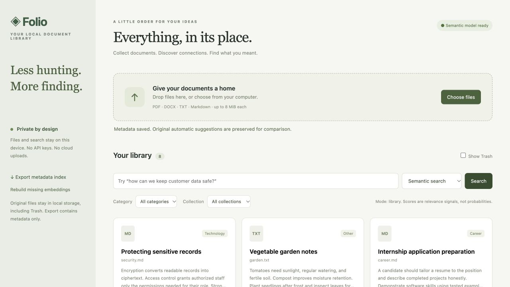

# AI Document Organizer · Folio

A local-first Python document library with real pretrained embeddings, SQLite persistence, explainable metadata suggestions, and a lightweight web interface. No paid APIs, API keys, cloud accounts, custom classifier training, or frontend build tools.



## macOS installation and launch

Tested on Apple Silicon macOS with Python 3.12.14. Requires Python **3.11+**; install a compatible Python from https://www.python.org/downloads/macos/ if needed. In the extracted project folder:

```sh
python3 -m venv .venv
source .venv/bin/activate
python -m pip install -r requirements.txt
python setup_model.py
python app.py
```

Open **http://127.0.0.1:8000**. Stop with Ctrl+C. If the port is busy: `python app.py --port 8001`. No Node.js, GPU, database server, or account is needed. Installation downloads Python packages; `setup_model.py` downloads roughly 90 MB of public model weights plus tokenizer/config files into `data/model`. It pins the tested model revision and never reads your documents. First model initialization can take several seconds.

After setup, normal ingestion/search runs offline: the application loads only the local model (`local_files_only=True`, offline Hub mode, CPU, remote model code disabled). It never invokes a hosted inference API. Missing/broken model installation causes a visible **keyword-only fallback**, rather than silently pretending to provide semantic retrieval.

For a smaller install without PyTorch/Sentence Transformers:

```sh
python -m pip install -r requirements-lite.txt
python app.py --keyword-only
```

Later install `requirements.txt`, run `python setup_model.py`, restart normally, and choose **Rebuild missing embeddings**. Existing chunk vectors are reused. If using a custom data location, pass the same `--data-dir /path/to/library` to setup and app; evaluation accepts `--model-dir /path/to/library/model`.

## What works

- Drag/drop or choose PDF, DOCX, UTF-8 TXT and Markdown files; sequential file-level progress and actionable errors.
- Plain-text preview, original download, content-based duplicate detection, and local storage.
- Automatic suggested title, keywords, extractive summary, and seven rule-based categories plus Other. Original suggestions/evidence are kept separate from user edits. Classification strength is a heuristic, **not a calibrated confidence probability**.
- Search filenames/content with keyword matching, natural-language meaning with MiniLM cosine similarity, or a hybrid score. Matching chunk excerpts and scores are shown; scores are **not probabilities**.
- Edit titles, summaries, categories, and tags. Assign one collection per document; entering a new collection name creates it. Filter by category/collection.
- Move documents to reversible Trash and restore them. Originals, text, and cached vectors remain on disk; no permanent-purge feature is included.
- Export the active metadata index as JSON. It excludes full text, originals, embeddings and Trash; it is not a complete backup.

Start with the eight synthetic TXT/Markdown documents in `samples/` (upload through the UI). The shipped library is empty; the screenshot shows an explicitly populated test library. No real personal documents were used.

## How retrieval works

Extracted text is bounded at 80,000 characters; overlapping windows contain 160 whitespace-delimited words with 32-word overlap, at most 200 chunks. A locally loaded `sentence-transformers/all-MiniLM-L6-v2` maps each chunk/query to a unit-normalized 384-dimensional vector. Document semantic score is the maximum dot product over its chunk vectors, equivalent to cosine similarity. The best chunk supplies the excerpt.

Keyword score measures query-term coverage plus literal substring matching across filename, title, tags, category and extracted content. It is a lightweight baseline, **not BM25**. Hybrid score is `0.7 * max(0, cosine) + 0.3 * keyword_score`. Queries with no text return the filtered library. Semantic mode can rank irrelevant documents at the bottom; no calibrated rejection threshold is implemented.

SQLite stores chunk vectors and a persistent cache keyed by model revision and chunk text hash. Duplicate uploads return the existing document. Metadata edits affect keyword search immediately; semantic vectors encode extracted content, not edited tags/title. Replacing content means uploading a new file; changed chunks get new vectors, while shared chunks reuse cached vectors. Text editing inside the app is not supported.

The model's 256-wordpiece limit can truncate unusually token-dense chunks despite word-window bounds. English documents are the intended scope. Scanned/image-only PDFs require OCR, **not included**. DOCX extraction reads body paragraphs and tables; headers, footnotes, layout, embedded images, tracked-change semantics, and complex PDF reading order are not fully reconstructed.

## Tests and measured evaluation

```sh
python -m pip install -r requirements-dev.txt
ORGANIZER_TEST_MODEL=data/model python -m unittest discover -s tests -v
python evaluate.py
```

Without `ORGANIZER_TEST_MODEL`, the real-model test is explicitly skipped; unit/API tests use a deterministic embedding fixture, not a pretend semantic model. The recorded evaluation uses the actual pretrained model. CI installs the real model and runs all tests without private documents. Hosted GitHub Actions execution was **not** performed; no repository was created.

Measured on eight author-written synthetic documents and eight paraphrased queries: keyword Recall@1 **4/8**, semantic **8/8**, hybrid **8/8**. This demonstrates the tested paraphrases only, not general search accuracy. See [EVALUATION.md](EVALUATION.md) and `results/evaluation.json` for all queries, ranks, model revision, and limitations. Running evaluation overwrites its report but never touches your library.

## Privacy and operational limits

All originals, extracted text, metadata, and vectors live under `data/` (ignored by Git). **Storage is not encrypted**; anyone with access to that directory can read it. Trash retains data. Exported summaries/tags may contain sensitive information. Back up the entire data directory while the server is stopped if you need a full backup.

Uploads are untrusted: 8 MiB each; 100 PDF pages; bounded expanded DOCX contents; safe UUID storage paths; type/signature/UTF-8 checks; subprocess extraction with CPU/wall limits and Linux memory limits; parameterized SQL; plain-text rendering; fixed asset/download routes; localhost Host/Origin checks. The parser process is a resource boundary, **not a hardened OS sandbox or malware scanner**. Original downloads should be treated as untrusted too. Keep the loopback-only server local; this is a single-user learning application, not a public multi-tenant service.

Limits: 500 documents including Trash, 200 chunks/document, 100 ranked results, synchronous serialized ingestion, no OCR, generative summaries, permanent purge, multi-collection membership, background job queue, cross-machine sync, or production authentication. Search scans SQLite chunk vectors in memory, appropriate for this bounded library, not millions of documents. Query embeddings are recomputed per search; document embeddings are cached. Reindex may take time on large libraries. Only the documented macOS environment was executed locally; Linux CI is configured but unverified on GitHub.

## Project map and attribution

`organizer/`: ingestion/service, extraction worker, chunking, embeddings, metadata rules, SQLite. `app.py`: local FastAPI routes. `web/`: accessible vanilla UI. `tests/`: synthetic unit/API/real-model checks. `samples/`: harmless demonstration documents. Documentation includes architecture, learning guide, interview preparation, resume bullets, and measured evaluation.

Model: [Sentence Transformers all-MiniLM-L6-v2](https://huggingface.co/sentence-transformers/all-MiniLM-L6-v2), Apache-2.0 per its model card. No custom classifier or embedding model was trained here. FastAPI, Uvicorn, NumPy, pypdf, PyTorch, Sentence Transformers and their dependencies retain their respective licenses. Model weights/packages are downloaded separately and not redistributed in the ZIP. Project code and synthetic samples are MIT licensed; see `LICENSE`. This is an AI-assisted project: understand and adapt the code before representing it as independent work.
